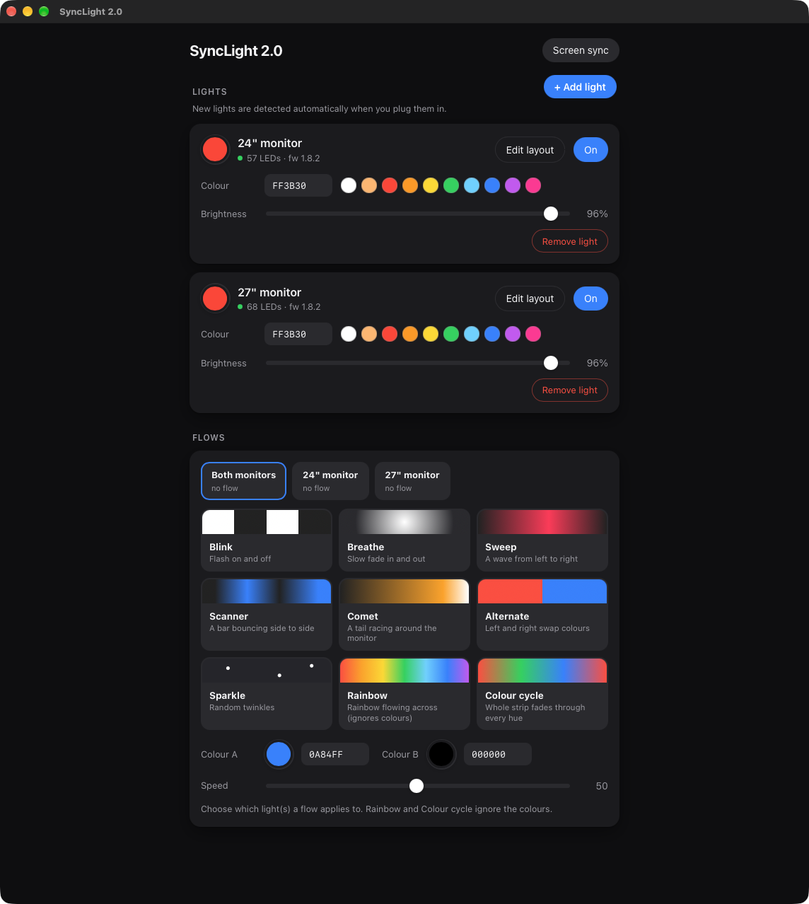

# SyncLight 2

A fast, glitch-free replacement for the **Robobloq SyncLight** app, for the USB monitor backlight strips that come with it. macOS only.



The official app drops lights, mixes them up and gets stuck. SyncLight 2 talks to the lights directly, reconnects on its own and remembers each light's colour, so a glitch never leaves a monitor in the wrong state.

## Features

- **Screen sync (ambilight)**: each monitor's backlight follows the edges of its own screen, smoothed and at up to 30 fps.
- **Colour wheel and hex entry** for every light, plus brightness, on/off and one-click presets.
- **Nine animated flows**: Blink, Breathe, Sweep (left to right), Scanner, Comet, Alternate, Sparkle, Rainbow, Colour cycle. Run a different flow on each monitor, or the same on all.
- **Add lights any time**: new lights are detected automatically. A short wizard asks which direction the strip runs (starts on the right or the left), how many LEDs are on each side and which monitor it belongs to. The strip lights up as you edit so you can see you got it right.
- **Reliable**: rescans USB every 2 seconds, reconnects dropped or sleeping lights, re-applies the last state, and sends commands one at a time per light.
- A real Mac app with its own icon. No account, no cloud, nothing leaves your computer.

## Supported hardware

| | |
|---|---|
| USB device | `ROBOBLOQ USBHID`, vendor `0x1A86`, product `0xFE07` |
| Tested firmware | 1.8.2 (two strips: 57 and 68 LEDs) |
| Connection | USB only |

To check whether your light is the same model, run `ioreg -p IOUSB -l | grep -B2 -A12 ROBOBLOQ` with the light plugged in and look for `idVendor = 6790` and `idProduct = 65031`.

**Not supported:** Robobloq's Bluetooth lights, the wireless dongle, serial-port variants, keyboards and mice. They use different transports. See [docs/PROTOCOL.md](docs/PROTOCOL.md) if you want to add one.

## Requirements

- macOS 13 or newer (Apple silicon or Intel)
- [Node.js](https://nodejs.org) 18 or newer (`brew install node`)
- Xcode Command Line Tools, for the Swift compiler (`xcode-select --install`)

## Install

```bash
git clone https://github.com/JawadZaheerKhan/synclight-robobloq.git
cd synclight-robobloq
./install.sh
```

The script installs the dependencies, builds the app and its screen-capture helper, and puts **SyncLight 2** in `~/Applications`. Because you build it yourself, macOS does not show an "unidentified developer" warning.

## First run

1. **Quit the official SyncLight app.** Only one program can control the lights at a time.
2. Open **SyncLight 2**. Each light that is plugged in appears as a card marked **NEW**; click **Set up**.
3. Pick the monitor, which side the strip starts on (looking at the monitor from the front), and the LED count for each side. Adjust until the colours on the strip line up with the edges: **white** is the first LED, then red, green and blue for each side in order.
4. To add more lights later, plug them in and click **+ Add light**.

Note that a light may *report* more LEDs than it physically has (one of the test strips reports 100 but has 57). Count the real LEDs when you set it up.

### Screen sync permission

The first time you turn on **Screen sync**, macOS needs your permission to capture the screen. Open **System Settings, Privacy & Security, Screen & System Audio Recording** and switch on **SyncLight 2** (if it isn't listed, click **+** and add `~/Applications/SyncLight 2.app`). Then quit and reopen the app. If you haven't granted it, the app tells you so instead of failing silently.

Screen contents are reduced to a tiny grid of colours in memory and are never saved or sent anywhere.

Rebuilding the app produces a new signature, so after an update macOS may ask for this permission again.

## Using it

- **Lights**: click the colour circle for the wheel, type a hex value, or tap a preset. The slider sets brightness.
- **Flows**: pick which light(s) at the top of the Flows card, then a flow. Colour A and B and the speed change it live.
- **Screen sync**: the button at the top right. Starting a flow stops sync and the other way round. Changing a light's colour stops its flow.
- **Start at login**: add SyncLight 2 under System Settings, General, Login Items.

Your settings (names, layouts, last colours) are stored in `~/Library/Application Support/SyncLight 2/`, so updating or reinstalling never loses them. Logs are in `~/Library/Logs/SyncLight 2.log`.

## Troubleshooting

| Problem | Fix |
|---|---|
| A light doesn't show up | Quit the official SyncLight app (it holds the lights exclusively), unplug and replug, then click **+ Add light**. |
| "Node.js is required" | Install Node 18+ and reopen the app. |
| Screen sync shows an error or stays dark | Grant Screen Recording permission (above), then toggle sync off and on. |
| Colours are on the wrong edges | Open **Edit layout** on the light and fix the start side or LED counts. The preview shows the order. |
| Lights look wrong after an update | Open the app once; it restores each light's saved state. |

## Uninstall

Delete `~/Applications/SyncLight 2.app`. To also remove your settings, delete `~/Library/Application Support/SyncLight 2/`.

## Running from source

```bash
npm install
npm start          # controller on http://127.0.0.1:7878 (open it in any browser)
npm test           # unit tests: protocol framing, layouts, screen-edge mapping, flows
```

`SYNCLIGHT_DATA=/some/folder npm start` keeps settings somewhere else. For quick experiments without the UI, `node src/cli.js list` and `node src/cli.js color all 255 0 0` work too (stop the app first, since it holds the lights).

### How it fits together

| Part | What it does |
|---|---|
| `src/light.js` | USB HID driver: builds the light's command frames and streams LED colours |
| `src/manager.js` | Keeps every light connected, reconnects, queues writes, restores state |
| `src/sync.js` + `helper/capture.swift` | ScreenCaptureKit helper plus edge sampling for screen sync |
| `src/effects.js` | The flows, rendered from each LED's position on the monitor |
| `src/layout.js` | Strip shapes (which edge, which direction) |
| `src/server.js` + `public/index.html` | Local web server and the interface |
| `app/` | The native macOS wrapper (a window around the interface) and the icon generator |

## Contributing

Bug reports and pull requests are welcome, especially for other Robobloq models. Please run `npm test` first, and include the output of `node src/cli.js list` with your hardware details when reporting a device problem.

## Disclaimer

SyncLight 2 is an independent project. It is not affiliated with, endorsed by or supported by Robobloq. "SyncLight" and "Robobloq" belong to their owners. The light protocol was worked out by observing how the official app talks to hardware the author owns, in order to make it work with a different program; no Robobloq code is included here. Use at your own risk.

## License

[MIT](LICENSE)
